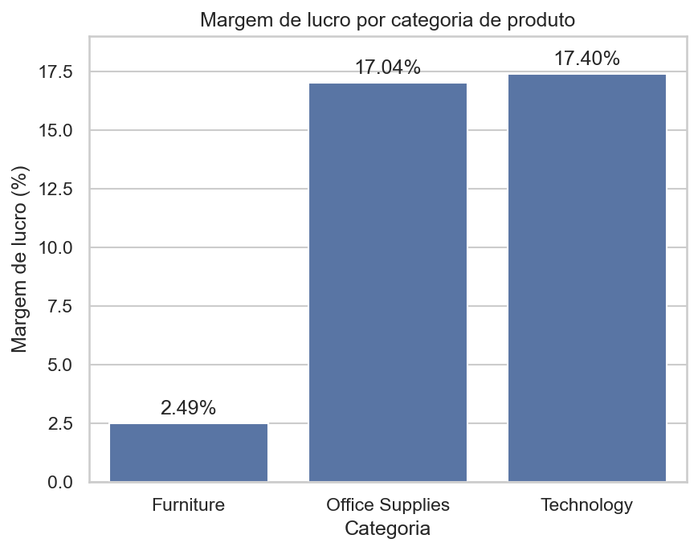
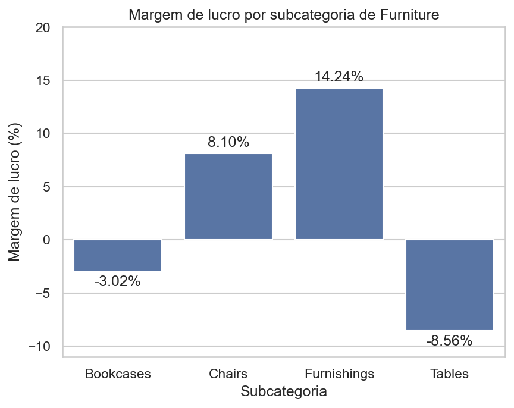
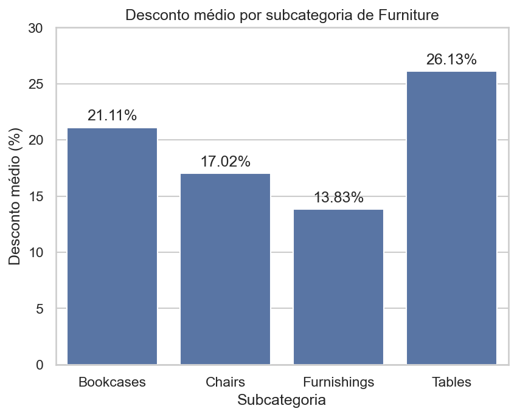

# Análise de Vendas de Varejo Focada na Rentabilidade das Categorias

Este projeto analisa as vendas de uma empresa de varejo dos Estados Unidos entre 2014 e 2018, buscando entender o desempenho de diferentes categorias em relação à lucratividade de suas vendas.

A análise foi feita em Jupyter Notebook, com Python (pandas, seaborn e matplotlib), usando um [dataset público do Kaggle](https://www.kaggle.com/datasets/shandeep777/retail-supply-chain-sales-dataset/data)..

## Pergunta de Negócio

Qual é a lucratividade de cada categoria de produto, e quais fatores explicam as diferenças encontradas entre elas?

## Principais Resultados

- A categoria 'Furniture' tem a menor margem de lucro, de 2,49%, contra 17,04% de 'Office Supplies' e 17,40% de 'Technology'.



- Dentro de 'Furniture', o prejuízo se concentra em 'Bookcases' e 'Tables', com margens de -3,02% e -8,56%, respectivamente.



- Essas subcategorias também têm os maiores descontos médios (21,11% e 26,13%), o que sugere uma associação entre desconto alto e margem menor.




## Como Reproduzir

1. Clone o repositório e entre na pasta do projeto:

   ```bash
   git clone https://github.com/jvribeirocostard/Retail-sales-analysis.git
   cd Retail-sales-analysis
   ```

2. Instale as dependências: `pip install -r requirements.txt`
3. Abra o Jupyter com `jupyter notebook`, acesse `notebooks/retail-sales.ipynb` e execute todas as células. O dataset já está na pasta `data/`.


